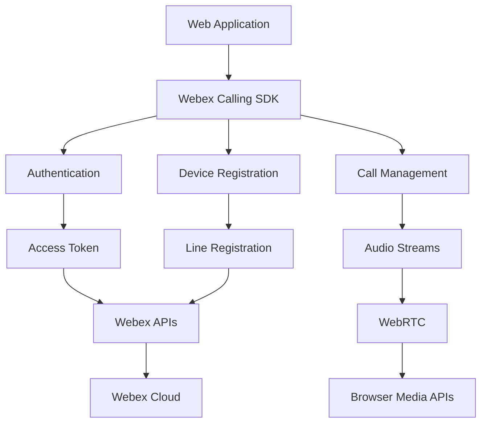

# Webex Web Calling SDK Samples

[](https://developer.mozilla.org/en-US/docs/Web/JavaScript)
[](https://www.npmjs.com/package/webex)
[](https://developer.cisco.com/site/license/cisco-sample-code-license/)
[](https://developer.mozilla.org/en-US/docs/Web/Guide/HTML/HTML5)

## Overview

This repository contains **comprehensive examples** demonstrating how to quickly integrate the **Webex Web Calling SDK** into your web applications. The samples showcase voice calling capabilities including device registration, call management, and audio handling using the latest Webex JavaScript SDK.

### Key Features

✅ **Two Integration Methods**: CDN and NPM package implementations  
✅ **Voice Calling**: Place and receive voice calls through Webex  
✅ **Device Registration**: Register and manage calling devices  
✅ **Audio Management**: Handle local and remote audio streams  
✅ **Real-time Events**: Listen to call states and events  
✅ **Ready-to-Use**: Complete working examples with minimal setup

### Use Cases

- **Softphone Applications**: Build web-based calling interfaces
- **Customer Support Tools**: Integrate calling into support platforms
- **Unified Communications**: Add voice calling to existing web apps
- **Contact Center Solutions**: Build browser-based agent tools
- **VoIP Applications**: Create web-based communication platforms

## Table of Contents

- [Prerequisites](#prerequisites)
- [Project Structure](#project-structure)
- [Quick Start](#quick-start)
- [Implementation Methods](#implementation-methods)
  - [CDN Implementation](#cdn-implementation)
  - [NPM Implementation](#npm-implementation)
- [Configuration](#configuration)
- [Usage Guide](#usage-guide)
- [API Reference](#api-reference)
- [Audio Handling](#audio-handling)
- [Event Management](#event-management)
- [Troubleshooting](#troubleshooting)
- [Best Practices](#best-practices)
- [Contributing](#contributing)
- [License](#license)

## Prerequisites

### Required Accounts & Credentials
- **[Webex Developer Account](https://developer.webex.com/)** - Sign up for free
- **Webex Access Token** - Generated from Developer Portal or OAuth flow
- **Webex Calling License** - Required for voice calling functionality

### Browser Requirements
- **Modern Web Browser** with WebRTC support:
  - Chrome 70+ (recommended)
  - Firefox 65+
  - Safari 12+
  - Edge 79+

### Development Environment
- **Web Server** - For serving files locally (included in NPM sample)
- **HTTPS Support** - Required for microphone access in production

### Calling Prerequisites
- **Webex Calling Organization** - Must have Webex Calling enabled
- **User License** - User must have Webex Calling license assigned
- **Device Registration** - Calling device must be registered

## Project Structure

```
web-calling-sdk-samples/
├── cdn/                          # CDN-based implementation
│   ├── index.html               # Complete HTML interface
│   └── app.js                   # JavaScript implementation
├── npm/                          # NPM package implementation
│   ├── package.json             # Dependencies and scripts
│   ├── webpack.config.js        # Webpack configuration
│   └── src/
│       ├── index.html           # HTML interface
│       └── index.js             # ES6 module implementation
├── LICENSE                       # Cisco Sample Code License
└── README.md                     # This documentation
```

### Architecture Overview



## Quick Start

### Choose Your Implementation Method

#### Option 1: CDN (Fastest Setup)
```bash
# Navigate to CDN folder
cd cdn

# Open index.html in a web server
# For quick testing with Python:
python3 -m http.server 8000
# Then visit: http://localhost:8000
```

#### Option 2: NPM (Production Ready)
```bash
# Navigate to NPM folder
cd npm

# Install dependencies
npm install

# Build the application
npm run build

# Start the development server
npm start
# Then visit: http://localhost:1234
```

## Implementation Methods

### CDN Implementation

The CDN approach loads the Webex Calling SDK directly from a CDN, making it ideal for rapid prototyping and simple integrations.

#### HTML Structure (`cdn/index.html`)

```html
<!DOCTYPE html>
<html lang="en">
<head>
    <meta charset="UTF-8">
    <title>@webex/calling Quickstart</title>
</head>
<body>
    <!-- Authentication Section -->
    <section id="authentication">
        <h2>@webex/calling Quickstart</h2>
        <fieldset>
            <legend>Credentials</legend>
            <input id="access-token" placeholder="Access Token" type="text" required>
            <button id="init" onclick="init()">Initialize Calling</button>
            <pre id="access-token-status">Not initialized</pre>
        </fieldset>
        
        <!-- Device Registration -->
        <fieldset>
            <legend>Authorization with Webex Calling</legend>
            <button id="authenticate_device" onclick="authorize()">Authorize device</button>
            <pre id="registration-status">Unregistered</pre>
            <button id="deregister_device" onclick="deregister()">Delete Device</button>
        </fieldset>
    </section>

    <!-- Call Management -->
    <section id="calls">
        <fieldset>
            <legend>Calls</legend>
            <input id="destination-number" placeholder="Destination Number" type="text" required>
            <button id="call" onclick="makeCall()">Place call</button>
            <pre id="call-details">No Call</pre>
            <button id="call" onclick="endCall()">End call</button>
        </fieldset>
    </section>

    <!-- Audio Elements -->
    <audio id="local-audio" muted="true" autoplay></audio>
    <audio id="remote-audio" autoplay></audio>

    <!-- SDK Loading -->
    <script src="https://unpkg.com/webex@2.59.8-next.10/umd/calling.min.js"></script>
    <script src="app.js"></script>
</body>
</html>
```

#### JavaScript Implementation (`cdn/app.js`)

```javascript
/* global Calling */

// DOM element references
const accessToken = document.querySelector('#access-token');
const authStatusElm = document.querySelector('#access-token-status');
const localAudioElem = document.querySelector('#local-audio');
const remoteAudioElem = document.querySelector('#remote-audio');
const callDetailsElm = document.querySelector('#call-details');
const registerStatus = document.querySelector('#registration-status');

// Global variables
let calling;
let line;
let localAudioStream;
let call;

async function init() {
    // Webex SDK configuration
    const webexConfig = {
        config: {
            logger: { level: 'debug' },
            meetings: {
                reconnection: { enabled: true },
                enableRtx: true,
            },
            encryption: {
                kmsInitialTimeout: 8000,
                kmsMaxTimeout: 40000,
                batcherMaxCalls: 30,
                caroots: null,
            },
            dss: {},
        },
        credentials: {
            access_token: accessToken.value,
        }
    };
    
    // Calling-specific configuration
    const callingConfig = {
        clientConfig: {
            calling: true,
            contact: true,
            callHistory: true,
            callSettings: true,
            voicemail: true,
        },
        callingClientConfig: {
            logger: { level: 'info' }
        },
        logger: { level: 'info' }
    };

    // Initialize the calling SDK
    calling = await Calling.init({webexConfig, callingConfig});
    authStatusElm.innerHTML = 'Initializing...';

    calling.on("ready", () => {
        calling.register().then(() => {
            callingClient = calling.callingClient;  
            authStatusElm.innerHTML = 'Ready';
        });
    });
}
```

### NPM Implementation

The NPM approach uses the Webex SDK as a dependency, providing better dependency management and build optimization for production applications.

#### Package Configuration (`npm/package.json`)

```json
{
    "name": "calling-dummy",
    "version": "1.0.0",
    "description": "Webex Calling SDK NPM implementation",
    "main": "index.js",
    "license": "MIT",
    "dependencies": {
        "webex": "2.59.8-next.10",
        "http-server": "^14.1.1"
    },
    "devDependencies": {
        "webpack": "^5.88.2",
        "webpack-cli": "^5.1.4"
    },
    "scripts": {
        "start": "http-server ./src -p 1234",
        "build": "webpack"
    }
}
```

#### Webpack Configuration (`npm/webpack.config.js`)

```javascript
const webpack = require("webpack");
const path = require("path");

module.exports = {
    mode: "development",
    entry: "./src/index.js",
    output: {
        filename: "main.js",
        path: path.resolve(__dirname, "./src/dist"),
    },
    resolve: {
        fallback: {
            http: require.resolve("stream-http"),
            https: require.resolve("https-browserify"),
            crypto: require.resolve("crypto-browserify"),
            stream: require.resolve("stream-browserify"),
            os: require.resolve("os-browserify/browser"),
            url: require.resolve("url"),
            assert: require.resolve("assert"),
            fs: false,
            querystring: require.resolve("querystring-es3"),
        },
    },
    plugins: [
        new webpack.ProvidePlugin({
            process: "process/browser",
        }),
    ],
};
```

#### ES6 Module Implementation (`npm/src/index.js`)

```javascript
import Calling from "webex/calling";

let callingClient;
let line;
let calling;

// Configuration objects
const webexConfig = {
    config: {
        logger: { level: "debug" },
        meetings: {
            reconnection: { enabled: true },
            enableRtx: true,
        },
        encryption: {
            kmsInitialTimeout: 8000,
            kmsMaxTimeout: 40000,
            batcherMaxCalls: 30,
            caroots: null,
        },
        dss: {},
    },
    credentials: {
        access_token: "YOUR_ACCESS_TOKEN_HERE",
    },
};

const callingConfig = {
    clientConfig: {
        calling: true,
        contact: true,
        callHistory: true,
        callSettings: true,
        voicemail: true,
    },
    callingClientConfig: {
        logger: { level: "info" },
    },
    logger: { level: "info" },
};

// Initialize calling functionality
async function callingInit() {
    calling = await Calling.init({ webexConfig, callingConfig });
    
    calling.on("ready", () => {
        calling.register().then(() => {
            callingClient = calling.callingClient;
        });
    });
}

// Register calling line
async function registerLine() {
    line = Object.values(callingClient.getLines())[0];
    
    line.on("registered", (lineInfo) => {
        console.log("Line information: ", lineInfo);
    });
    
    line.register();
}

// Export functions to global scope for HTML access
window.registerLine = registerLine;
window.callingInit = callingInit;
```

## Configuration

### Required Configuration Parameters

| Parameter | Description | Example |
|-----------|-------------|---------|
| `access_token` | Valid Webex access token | `Bearer eyJ0eXAiOiJKV1Q...` |
| `logger.level` | Logging verbosity | `'debug'`, `'info'`, `'warn'`, `'error'` |
| `clientConfig.calling` | Enable calling functionality | `true` |
| `clientConfig.contact` | Enable contact management | `true` |
| `clientConfig.callHistory` | Enable call history | `true` |

### Advanced Configuration Options

#### WebRTC Configuration
```javascript
const webexConfig = {
    config: {
        meetings: {
            reconnection: { enabled: true },
            enableRtx: true,                    // Enable retransmissions
            enableExtmap: true,                 // Enable extension mapping
        },
        encryption: {
            kmsInitialTimeout: 8000,            // Key management timeout
            kmsMaxTimeout: 40000,               // Maximum KMS timeout
            batcherMaxCalls: 30,                // Batch call limit
        }
    }
};
```

#### Audio Configuration
```javascript
const audioConfig = {
    constraints: {
        audio: {
            echoCancellation: true,
            noiseSuppression: true,
            autoGainControl: true,
            sampleRate: 48000,
            channelCount: 1
        }
    }
};
```

## Usage Guide

### Step-by-Step Implementation

#### 1. Initialize the SDK

```javascript
// Set up configuration
const webexConfig = { /* configuration */ };
const callingConfig = { /* calling config */ };

// Initialize calling
const calling = await Calling.init({webexConfig, callingConfig});

// Wait for ready state
calling.on("ready", () => {
    console.log("Calling SDK is ready");
});
```

#### 2. Register Device

```javascript
// Register the calling client
await calling.register();

// Get the first available line
const line = Object.values(calling.callingClient.getLines())[0];

// Listen for registration events
line.on("registered", (lineInfo) => {
    console.log("Device registered:", lineInfo);
});

// Register the line
line.register();
```

#### 3. Handle Audio Streams

```javascript
// Create microphone stream
const localAudioStream = await Calling.createMicrophoneStream({audio: true});

// Attach to local audio element
document.querySelector('#local-audio').srcObject = localAudioStream.outputStream;
```

#### 4. Make a Call

```javascript
// Create a call
const call = line.makeCall({
    type: 'uri',
    address: 'user@example.com'  // or phone number
});

// Handle call events
call.on('progress', (correlationId) => {
    console.log('Call in progress');
});

call.on('established', (correlationId) => {
    console.log('Call established');
});

call.on('remote_media', (track) => {
    // Handle remote audio
    const remoteAudio = document.querySelector('#remote-audio');
    remoteAudio.srcObject = new MediaStream([track]);
});

// Dial the call
await call.dial(localAudioStream);
```

#### 5. End a Call

```javascript
// End the active call
call.end();

// Clean up audio streams
localAudioStream.stop();
```

## API Reference

### Core Classes and Methods

#### Calling Class

| Method | Description | Parameters | Returns |
|--------|-------------|------------|---------|
| `Calling.init()` | Initialize the calling SDK | `{webexConfig, callingConfig}` | `Promise<Calling>` |
| `calling.register()` | Register the calling client | None | `Promise<void>` |
| `calling.callingClient` | Get the calling client instance | None | `CallingClient` |

#### CallingClient Class

| Method | Description | Parameters | Returns |
|--------|-------------|------------|---------|
| `getLines()` | Get available calling lines | None | `Object<Line>` |
| `getCall(callId)` | Get call by ID | `callId: string` | `Call` |
| `getActiveCalls()` | Get all active calls | None | `Array<Call>` |

#### Line Class

| Method | Description | Parameters | Returns |
|--------|-------------|------------|---------|
| `register()` | Register the line | None | `Promise<void>` |
| `deregister()` | Deregister the line | None | `Promise<void>` |
| `makeCall(options)` | Create a new call | `{type, address}` | `Call` |

#### Call Class

| Method | Description | Parameters | Returns |
|--------|-------------|------------|---------|
| `dial(stream)` | Dial the call | `MediaStream` | `Promise<void>` |
| `answer(stream)` | Answer incoming call | `MediaStream` | `Promise<void>` |
| `end()` | End the call | None | `Promise<void>` |
| `hold()` | Put call on hold | None | `Promise<void>` |
| `resume()` | Resume held call | None | `Promise<void>` |

### Static Methods

#### Calling.createMicrophoneStream()

Creates a microphone audio stream for calling.

```javascript
const stream = await Calling.createMicrophoneStream({
    audio: {
        echoCancellation: true,
        noiseSuppression: true,
        autoGainControl: true
    }
});
```

**Parameters:**
- `constraints` (Object): Media constraints for audio capture

**Returns:**
- `Promise<LocalAudioStream>`: Audio stream object

## Audio Handling

### Audio Stream Management

```mermaid
graph LR
    A[Microphone] --> B[LocalAudioStream]
    B --> C[Call.dial()]
    D[Remote Audio] --> E[MediaTrack]
    E --> F[Audio Element]
    
    G[Local Audio Element] --> B
    G --> H[Muted for Feedback Prevention]
```

### Local Audio Setup

```javascript
// Create and configure local audio stream
async function setupLocalAudio() {
    const localStream = await Calling.createMicrophoneStream({
        audio: {
            echoCancellation: true,
            noiseSuppression: true,
            autoGainControl: true,
            sampleRate: 48000
        }
    });
    
    // Attach to audio element (muted to prevent feedback)
    const localAudio = document.querySelector('#local-audio');
    localAudio.srcObject = localStream.outputStream;
    localAudio.muted = true;  // Important: prevent audio feedback
    
    return localStream;
}
```

### Remote Audio Handling

```javascript
// Handle incoming remote audio
call.on('remote_media', (track) => {
    console.log('Received remote media track:', track);
    
    // Create media stream from track
    const remoteStream = new MediaStream([track]);
    
    // Attach to remote audio element
    const remoteAudio = document.querySelector('#remote-audio');
    remoteAudio.srcObject = remoteStream;
    remoteAudio.autoplay = true;
});
```

### Audio Quality Optimization

```javascript
// Configure audio constraints for optimal quality
const audioConstraints = {
    audio: {
        echoCancellation: true,        // Remove echo
        noiseSuppression: true,        // Reduce background noise
        autoGainControl: true,         // Automatic volume adjustment
        sampleRate: 48000,            // High quality sample rate
        channelCount: 1,              // Mono audio for calls
        latency: 0.02,                // Low latency (20ms)
        volume: 1.0                   // Full volume
    }
};
```

## Event Management

### Call Events

```javascript
// Complete call event handling
call.on('caller_id', (callerIdInfo) => {
    console.log('Caller ID:', callerIdInfo.callerId);
    // Update UI with caller information
});

call.on('progress', (correlationId) => {
    console.log('Call progress:', correlationId);
    // Show "calling..." state
});

call.on('connect', (correlationId) => {
    console.log('Call connected:', correlationId);
    // Show "connected" state
});

call.on('established', (correlationId) => {
    console.log('Call established:', correlationId);
    // Show "active call" state
    // Enable call controls (mute, hold, etc.)
});

call.on('disconnect', (correlationId) => {
    console.log('Call disconnected:', correlationId);
    // Clean up UI and audio streams
    // Reset call state
});

call.on('remote_media', (track) => {
    console.log('Remote media received:', track);
    // Handle incoming audio/video
});
```

### Line Events

```javascript
// Line registration events
line.on('registered', (lineInfo) => {
    console.log('Line registered successfully');
    console.log('Device ID:', lineInfo.mobiusDeviceId);
    console.log('User ID:', lineInfo.userId);
    console.log('SIP Address:', lineInfo.sipAddresses[0]);
});

line.on('unregistered', (reason) => {
    console.log('Line unregistered:', reason);
});

line.on('incoming_call', (call) => {
    console.log('Incoming call received:', call);
    // Handle incoming call UI
    // Show answer/decline options
});
```

### Calling Client Events

```javascript
// Calling client events
calling.on('ready', () => {
    console.log('Calling client is ready');
});

calling.on('error', (error) => {
    console.error('Calling client error:', error);
});
```

## Troubleshooting

### Common Issues

#### 1. Authentication Errors
**Problem**: 401 Unauthorized errors during initialization.

**Solutions**:
- Verify access token is valid and not expired
- Ensure token has calling scopes
- Check that user has Webex Calling license

```javascript
// Debug authentication
console.log('Access token:', accessToken.substring(0, 20) + '...');
```

#### 2. Device Registration Failures
**Problem**: Line registration fails or times out.

**Solutions**:
- Verify user has Webex Calling license
- Check network connectivity
- Ensure organization has Webex Calling enabled

```javascript
// Debug registration
line.on('registration_failed', (error) => {
    console.error('Registration failed:', error);
});
```

#### 3. Audio Issues
**Problem**: No audio during calls or microphone not working.

**Solutions**:
- Check browser permissions for microphone access
- Verify HTTPS is used (required for getUserMedia)
- Test microphone with other applications

```javascript
// Test microphone access
navigator.mediaDevices.getUserMedia({audio: true})
    .then(stream => console.log('Microphone access granted'))
    .catch(error => console.error('Microphone access denied:', error));
```

#### 4. Call Connection Issues
**Problem**: Calls fail to connect or have poor quality.

**Solutions**:
- Check network firewall settings
- Verify WebRTC is supported in browser
- Test with different browsers

```javascript
// Debug call states
call.on('connect', () => console.log('Call connected'));
call.on('disconnect', () => console.log('Call disconnected'));
```

### Debug Configuration

```javascript
// Enable comprehensive debugging
const debugConfig = {
    config: {
        logger: {
            level: 'debug',
            historyLength: 1000
        }
    },
    callingClientConfig: {
        logger: {
            level: 'debug'
        }
    }
};
```

### Browser Compatibility Testing

```javascript
// Check WebRTC support
function checkWebRTCSupport() {
    const isSupported = !!(
        navigator.getUserMedia ||
        navigator.webkitGetUserMedia ||
        navigator.mozGetUserMedia ||
        navigator.msGetUserMedia ||
        navigator.mediaDevices?.getUserMedia
    );
    
    console.log('WebRTC supported:', isSupported);
    return isSupported;
}
```

## Best Practices

### Security

1. **Token Management**:
   ```javascript
   // ❌ Don't store tokens in localStorage
   localStorage.setItem('token', accessToken);
   
   // ✅ Use secure, httpOnly cookies or server-side storage
   // Store tokens server-side and use session authentication
   ```

2. **HTTPS Requirement**:
   ```javascript
   // ✅ Always use HTTPS in production
   if (location.protocol !== 'https:' && location.hostname !== 'localhost') {
       console.warn('HTTPS required for microphone access');
   }
   ```

### Performance

1. **Resource Cleanup**:
   ```javascript
   // ✅ Clean up resources when done
   function cleanupCall() {
       if (localAudioStream) {
           localAudioStream.stop();
       }
       if (call) {
           call.end();
       }
   }
   
   // Clean up on page unload
   window.addEventListener('beforeunload', cleanupCall);
   ```

2. **Event Listener Management**:
   ```javascript
   // ✅ Remove event listeners to prevent memory leaks
   function removeCallListeners() {
       call.off('progress');
       call.off('established');
       call.off('disconnect');
   }
   ```

### User Experience

1. **Loading States**:
   ```javascript
   // ✅ Show loading states during initialization
   function showLoadingState(message) {
       document.querySelector('#status').textContent = message;
   }
   
   showLoadingState('Initializing calling...');
   ```

2. **Error Handling**:
   ```javascript
   // ✅ Provide user-friendly error messages
   function handleCallError(error) {
       const userMessage = getErrorMessage(error);
       showUserNotification(userMessage, 'error');
   }
   ```

### Production Deployment

1. **Environment Configuration**:
   ```javascript
   // Use environment-specific configuration
   const config = {
       development: {
           logger: { level: 'debug' },
           apiUrl: 'https://api-dev.webex.com'
       },
       production: {
           logger: { level: 'error' },
           apiUrl: 'https://api.webex.com'
       }
   };
   ```

2. **Error Monitoring**:
   ```javascript
   // Implement error tracking
   calling.on('error', (error) => {
       // Send to error tracking service
       errorTracker.captureException(error);
   });
   ```

## Contributing

We welcome contributions to improve these sample implementations!

### How to Contribute

1. **Fork the repository**
2. **Create a feature branch**:
   ```bash
   git checkout -b feature/your-improvement
   ```
3. **Test your changes**:
   - Test both CDN and NPM implementations
   - Verify functionality across different browsers
   - Test with various calling scenarios
4. **Submit a pull request**

### Contribution Guidelines

- **Code Style**: Follow JavaScript ES6+ best practices
- **Documentation**: Update README for new features
- **Testing**: Test with real Webex calling environment
- **Browser Support**: Ensure compatibility with supported browsers

### Development Setup

1. **Clone the repository**:
   ```bash
   git clone <repository-url>
   cd web-calling-sdk-samples
   ```

2. **Test CDN implementation**:
   ```bash
   cd cdn
   python3 -m http.server 8000
   ```

3. **Test NPM implementation**:
   ```bash
   cd npm
   npm install
   npm run build
   npm start
   ```

## License

This project is licensed under the **Cisco Sample Code License**.

### License Summary

- ✅ **Permitted**: Copy, modify, and redistribute for use with Cisco products
- ❌ **Prohibited**: Use independent of Cisco products or to compete with Cisco
- ℹ️ **Warranty**: Provided "as is" without warranty
- ℹ️ **Support**: Not supported by Cisco TAC

See the [LICENSE](LICENSE) file for full license terms.

---

## Additional Resources

### Webex Developer Resources
- [Webex Developer Portal](https://developer.webex.com/)
- [Webex JavaScript SDK Documentation](https://webex.github.io/webex-js-sdk/)
- [Webex Calling API Reference](https://developer.webex.com/docs/api/guides/webex-calling-api)
- [WebRTC API Documentation](https://developer.mozilla.org/en-US/docs/Web/API/WebRTC_API)

### SDK Resources
- [Webex JS SDK GitHub](https://github.com/webex/webex-js-sdk)
- [NPM Package: webex](https://www.npmjs.com/package/webex)
- [SDK Migration Guide](https://developer.webex.com/blog/webex-javascript-sdk-upgrade-guide)

### WebRTC Resources
- [WebRTC.org](https://webrtc.org/)
- [MDN WebRTC Guide](https://developer.mozilla.org/en-US/docs/Web/API/WebRTC_API)
- [WebRTC Samples](https://webrtc.github.io/samples/)

### Community & Support
- [Webex Developer Community](https://developer.webex.com/community)
- [Stack Overflow - Webex](https://stackoverflow.com/questions/tagged/webex)
- [Webex Developer Support](https://developer.webex.com/support)

---

**Start Building Amazing Calling Experiences!** 🚀📞
